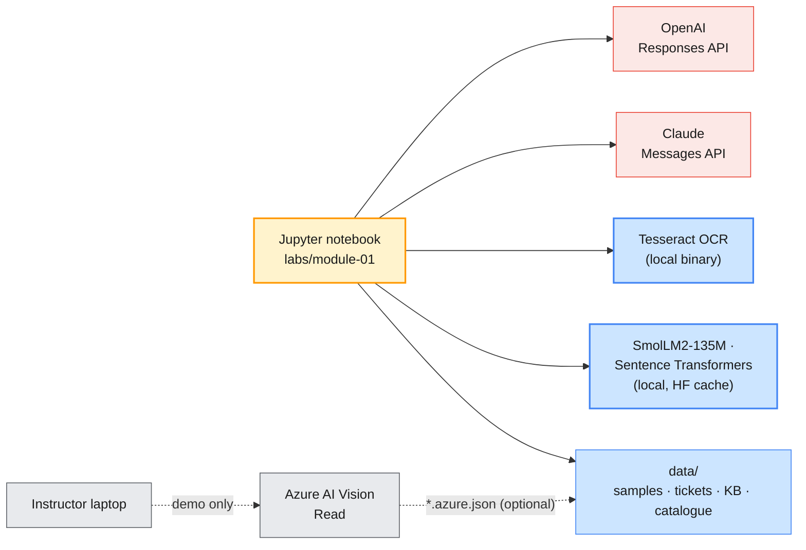

# Module 1 Labs — GenAI, NLP, OCR & LLM Fundamentals

> **Course:** Agentic AI Systems Engineering (Python track)
> **Companion guide:** [`guides/module-01-genai-nlp-ocr-llm-fundamentals.md`](../../guides/module-01-genai-nlp-ocr-llm-fundamentals.md)
> **Module objective:** Apply NLP, multilingual embeddings, and OCR (open-source and cloud) in enterprise document intelligence workflows.

In these three labs you put both providers' APIs side by side and watch how LLMs behave at their
edges: sampling, hallucination, the context window. You then build a small document-intelligence
pipeline, from scanned ticket to OCR to multilingual embedding to knowledge-base article. Finally you
make a costed, defensible model choice for four enterprise IT scenarios. The labs climb from guided
to open-ended, so do them in order.

| # | Lab | Level | Time | Covers | What you will do |
| - | --- | ----- | ---- | ------ | ---------------- |
| 01 | [Exploring LLM behaviour with OpenAI and Claude](lab-01-exploring-llm-behaviour.md) | Beginner | 60 min | Environment check (15 min, setup) + H2 | Dual-SDK first calls, temperature on a local model, sampling limits of hosted APIs, hallucination probes, verifiable grounding, token counting, truncation, a pre-flight guard |
| 02 | [Document intelligence: OCR and multilingual embeddings](lab-02-ocr-multilingual-embeddings.md) | Beginner → Intermediate | 75 min | H3, H4 | Tesseract and CER, page segmentation and preprocessing, AI-assisted OCR with structured output on both providers, cloud OCR demo, multilingual ticket-to-KB matching |
| 03 | [Mapping use cases and selecting models](lab-03-use-cases-model-selection.md) | Intermediate | 45 min | H1, H5 | Map four IT scenarios to agent types and model families, a dual-provider review, a monthly cost model, a weighted decision matrix and the model comparison sheet |

Estimated total: **about 3 h**: the outline's 165 minutes of hands-on, plus 15 minutes of labelled
environment setup at the start of Lab 01.

> **Scheduling.** H1 (use-case mapping) is first in the outline. Instructors may run Lab 03
> Parts 1–2 on the Day 1 morning, straight after the GenAI landscape topic, and keep Parts 3–4 for
> the end of the day. The module table gives Module 1 six hours, while the delivery schedule gives it
> all of Day 1 (course map §4 #1). The labs fit either.

---

## Prerequisites

| Requirement | Check with | Notes |
| ----------- | ---------- | ----- |
| Python 3.12+ and the course venv | `python --version` | See [`labs/setup/README.md`](../setup/README.md) |
| Course packages | `python labs/setup/check_env.py --module 1` | Pinned in `labs/setup/requirements.txt` |
| OpenAI and Anthropic keys in `.env` | `check_env.py` shows ✅ | Provided for the bootcamp; never commit `.env` |
| Tesseract OCR 5.x | `tesseract --version` | Lab 02 only. Without it, the Tesseract cells print a note and skip; the rest still runs |
| Local models cached | `python labs/setup/prefetch_models.py --module 1` | About 830 MB (SmolLM2-135M + two Sentence Transformers models). Offline without them, Lab 01 uses an illustrative logits vector and Lab 02 skips the embedding parts |
| Azure AI Vision | — | **Instructor only** (Lab 02 Part 4). Participants need no cloud credentials |

---

## Lab environment

Everything except the two model APIs runs on your laptop: Tesseract, a 135M-parameter language
model, two embedding models and the tokeniser. The cloud OCR demo runs from the instructor's
machine.



| Setting | Where | Used by |
| ------- | ----- | ------- |
| `OPENAI_API_KEY`, `OPENAI_MODEL` | `.env` | Every lab |
| `ANTHROPIC_API_KEY`, `ANTHROPIC_MODEL` | `.env` | Every lab |
| `OPENAI_SMALL_MODEL` (must accept reasoning effort `none`) | `.env` | Lab 01 temperature sweep · Lab 03 tier probe |
| `ANTHROPIC_SMALL_MODEL` | `.env` | Lab 03 tier probe |
| `OPENAI_EMBEDDING_MODEL` | `.env` | Lab 02 optional hosted-embedding comparison |
| `AZURE_VISION_ENDPOINT`, `AZURE_VISION_KEY` | instructor's `.env` | Lab 02 Part 4 demo |

Module 1 is in Phase 1, so the notebooks create both SDK clients directly instead of going
through `labs/setup/llm.py`: comparing the two APIs is the lesson. `LLM_PROVIDER` is not used here.

| Folder | Contents |
| ------ | -------- |
| `notebooks/` | Starter notebooks: run as-is; `TODO` functions raise `NotImplementedError` until you write them |
| `solutions/` | Reference notebooks: every TODO filled, every check passing |
| `data/` | `make_samples.py` (generates the OCR images + `ground_truth.json`), `kb/KB-0042.md`, `hallucination_probes.json`, `multilingual_tickets.csv`, `kb_articles.csv`, `use_case_scenarios.json`, `model_catalogue.json` |
| `templates/` | `model-comparison-sheet.md`: the Lab 03 artefact |
| `instructor/` | `cloud_ocr_demo.py` and its README: instructor only |
| `uv-projects/` | The three labs as standalone uv projects for terminal demos (`uv run lab01 all`); see its [README](uv-projects/README.md) |

### Everyday commands

```bash
# (terminal) - from the repo root
source .venv/bin/activate
python labs/setup/check_env.py --module 1
python labs/module-01/data/make_samples.py   # optional: the Lab 02 notebook runs it if needed
jupyter lab labs/module-01/notebooks/        # or open the folder in VS Code
```

> **Convention used in the labs**
>
> - `# (terminal)`: run in a shell with the course venv active, from the folder the block names.
> - `# (notebook)`: a cell in the lab's starter notebook.
> - `# (instructor)`: run by the instructor only (cloud demos, shared connectors).
> - **Expected** output is deterministic: it comes from a fixed model, fixed data or fixed code, and
>   was produced with the pinned versions. **Output shape** shows the format of model output, which
>   varies from run to run.
> - Check cells print ✅ (passed), ⏳ (your TODO is not done yet) or ⚠️ (skipped, with the reason).

---

## Troubleshooting

| Symptom | Likely cause | Fix |
| ------- | ------------ | --- |
| Setup cell prints `❌ OPENAI_API_KEY or OPENAI_MODEL missing` | `.env` missing, or edited after the kernel started | `cp labs/setup/.env.example .env`, add the keys, **restart the kernel** |
| `openai.BadRequestError` naming `temperature` outside Lab 01 Part 2 | `temperature`/`top_p` sent to a GPT-6 model at a reasoning effort other than `none` | Remove them, or use `OPENAI_SMALL_MODEL` with `reasoning={"effort": "none"}` |
| `TypeError: Messages.create() got an unexpected keyword argument 'temperature'` | The Anthropic SDK has no sampling arguments; current Claude models accept only the defaults | Remove the argument; get consistency from a constrained task and a schema |
| `KeyError: 'Could not automatically map gpt-6.1-sol to a tokeniser…'` | tiktoken 0.14 does not know the GPT-6 tokeniser | Count with `client.responses.input_tokens.count(...)`; use `o200k_base` only as an offline estimate |
| `⚠️ Could not load HuggingFaceTB/SmolLM2-135M (OSError)` or the embedding models are unavailable | Models not cached and no network | `python labs/setup/prefetch_models.py --module 1` |
| `TesseractNotFoundError`, or `❌ not installed` in the Lab 02 setup cell | Binary not installed or not on `PATH` | Install Tesseract (see setup README), then restart the kernel |
| Your CER numbers differ from the guide | Another Tesseract version (Ubuntu 22.04 ships 4.1) | Install 5.x for comparable numbers; the relationships between columns are what matter |
| `ValidationError` when you build a `UseCaseMapping` | A rationale under 40 characters, an unknown agent type, or fewer than two candidates | Read the field named in the error; the schema is the contract |

---

## Cleaning up after the module

```bash
# (terminal) - from labs/module-01
rm -rf outputs data/cloud_ocr      # filled comparison sheets, instructor OCR results
rm -rf data/samples                # generated images; make_samples.py recreates them
```

All three folders are git-ignored. Keep the Hugging Face cache and the venv: Module 2 uses the same
environment, and later modules use multilingual embeddings again for retrieval. The ticket
scenario, the `KB-…` articles and your Lab 03 comparison sheet carry into **Module 2**, where triage
becomes a prompt-engineering and structured-output problem on both SDKs.
