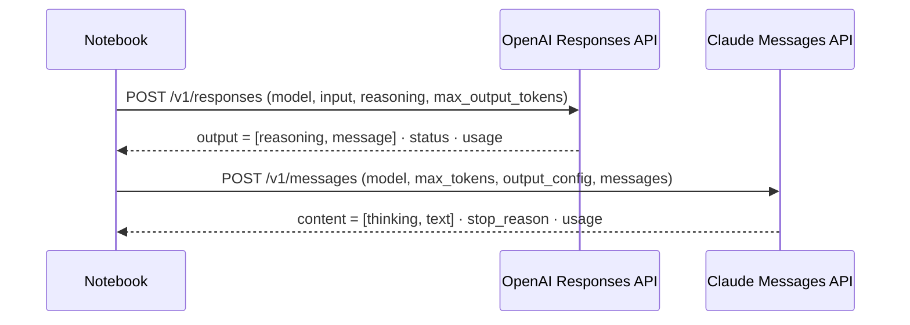
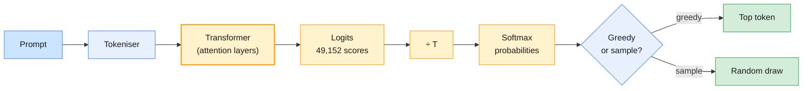
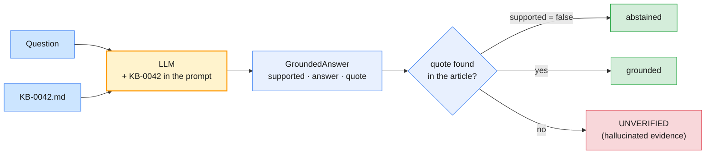
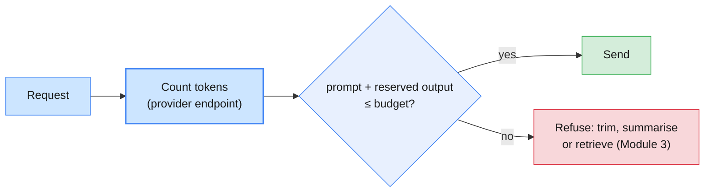

# Lab 01 — Exploring LLM behaviour with OpenAI and Claude

| | |
| --- | --- |
| **Level** | Beginner |
| **Duration** | ~60 minutes (15 min environment check + 45 min hands-on) |
| **Covers** | Environment check (setup) · H2 LLM behaviour exploration: hallucination triggers, context-window edge cases, temperature effects |
| **Guide sections** | §6.1 How an LLM generates text · §6.2 Sampling controls in current APIs · §6.3 Context windows · §6.4 Hallucinations · §6.6 Reading the response envelope · §3.1 Tokenisation |
| **Notebook** | [`notebooks/lab-01-exploring-llm-behaviour.ipynb`](notebooks/lab-01-exploring-llm-behaviour.ipynb) · solution in [`solutions/`](solutions/lab-01-exploring-llm-behaviour.ipynb) |
| **You will need** | The course venv and `.env` from [`labs/setup/`](../setup/README.md); both API keys; `python labs/setup/prefetch_models.py --module 1` run beforehand (SmolLM2-135M + `o200k_base`) |

## Learning objectives

By the end of this lab you will be able to:

1. **Call** the OpenAI Responses API and the Claude Messages API with the same prompt, and read each response's text, finish signal and token usage.
2. **Explain** temperature as a scaling of the logits before the softmax, and **measure** its effect on a local model's next-token distribution.
3. **State** which sampling controls the hosted APIs still accept in 2026, and **diagnose** the 400 and `TypeError` you get when you send the others.
4. **Trigger** five classes of hallucination and **verify** answers in code: DOI lookups, a version check, and a verbatim-quote check against a grounding document.
5. **Measure** how language changes token counts, and **recognise** output-budget truncation from `status` / `stop_reason`.
6. **Build** a pre-flight guard that counts tokens with the provider's own endpoint and refuses a request before it is sent.

---

## Part 1 — Check the environment and make your first calls (15 min)

You confirm the environment, then send one identical prompt to each provider and compare the response shapes (§6.6).

Run the check script first, from a terminal:

```bash
# (terminal) - from the repo root, venv active
python labs/setup/check_env.py --module 1
```

Fix every ❌ row before you go on (see [`labs/setup/README.md`](../setup/README.md)). Open the
notebook, run the **setup cell**, and confirm it prints a ✅ line for both providers:

**Expected** (your path differs):

```
Lab folder : /…/agentic-ai-python/labs/module-01
OpenAI     : ✅ gpt-6.1-sol
Claude     : ✅ claude-opus-5-5
```

> **Common trap:** you edited `.env` but the notebook still says ❌. The file is read when
> the kernel starts. Restart the kernel and run the setup cell again.

Now the two calls. They look alike, but the details differ in ways you will meet in every later lab:

```python
# (notebook)
oa_first = openai_client.responses.create(
    model=OPENAI_MODEL,
    input=PROMPT,
    reasoning={"effort": "low"},   # GPT-6 models reason before answering
    max_output_tokens=2_000,       # the cap covers reasoning tokens AND visible text
)

cl_first = claude_client.messages.create(
    model=ANTHROPIC_MODEL,
    max_tokens=2_000,              # required; covers thinking AND visible text
    output_config={"effort": "low"},
    messages=[{"role": "user", "content": PROMPT}],
)
```

**Output shape** (your text, token counts and timings will differ):

```
<two sentences about the L1 analyst role>

status=completed · input=… · output=… (reasoning …) · …s · id=resp_…

<two sentences about the L1 analyst role>

stop_reason=end_turn · input=… · output=… · …s · id=msg_…
```

The comparison cell lays the two shapes side by side:

| | OpenAI Responses API | Claude Messages API |
| --- | --- | --- |
| Request | `input` (string or items), optional `instructions` | `messages` list, optional `system`; `max_tokens` is required |
| Reasoning depth | `reasoning={"effort": …}` | `output_config={"effort": …}`; thinking is always on for `claude-opus-5-5` |
| Output items | `reasoning`, then `message` | `thinking` block(s), then `text` block(s) |
| Visible text | `response.output_text` (a convenience property) | Join the `text` blocks of `message.content` (the notebook's `claude_text()`) |
| Finished normally | `status == "completed"` | `stop_reason == "end_turn"` |
| Hidden reasoning in usage | `usage.output_tokens_details.reasoning_tokens` | Counted inside `usage.output_tokens` |



> **Bridge from what you know:** each call is a stateless RPC. Nothing is remembered between
> calls unless you send it again. Module 2 builds conversation state on top of this.

The last cell of Part 1 defines `ask_openai()` and `ask_claude()`. These are the same calls wrapped, so the
rest of the lab stays readable. The check cell then confirms both calls finished normally:

**Expected:** `✅ Part 1 — first calls`

---

## Part 2 — Temperature and sampling (15 min)

You see temperature work inside a model you can fully inspect (§6.1). Then you find out what the hosted APIs let you control (§6.2).

A model produces one score per vocabulary token (the **logits**). Temperature *T* divides them
before the softmax, so *T* < 1 sharpens the distribution and *T* > 1 flattens it:



The notebook loads `HuggingFaceTB/SmolLM2-135M` (135M parameters, cached by the prefetch script)
and scores the next token after *"If you forget your password, click the link to"*:

```python
# (notebook)
with torch.no_grad():
    inputs = tokenizer(NEXT_TOKEN_PROMPT, return_tensors="pt")
    logits = local_lm(**inputs).logits[0, -1]      # one score per vocabulary entry

for t in TEMPERATURES:
    probs = torch.softmax(logits / t, dim=-1)
```

**Expected** (SmolLM2-135M on CPU, torch 2.14; the last decimal can differ elsewhere):

```
T=0.2: entropy  0.99 nats · top-1 probability 0.574
T=0.7: entropy  3.27 nats · top-1 probability 0.179
T=1.0: entropy  4.56 nats · top-1 probability 0.096
T=1.5: entropy  6.84 nats · top-1 probability 0.030
           T=0.2  T=0.7  T=1.0  T=1.5
' reset'   0.574  0.179  0.096  0.030
' the'     0.348  0.158  0.084  0.029
' log'     0.047  0.096  0.058  0.022
' change'  0.010  0.066  0.045  0.018
' get'     0.010  0.066  0.045  0.018
' your'    0.006  0.051  0.040  0.017
```

Then 20 sampled continuations per temperature (fixed seed 7):

**Expected:**

```
 greedy:  1 distinct of  1 · e.g. ' reset your password.\n\nIf you'
  T=0.3: 18 distinct of 20 · e.g. ' your account and enter your password.\n'
  T=1.0: 20 distinct of 20 · e.g. ' your inbox at any time, or lock'
  T=1.5: 20 distinct of 20 · e.g. ' your inbox entitled Fact List rented spaces\n'
```

What to notice:

- At *T* = 0.2 the model is nearly certain (` reset` at 57%, ` the` at 35%). At *T* = 1.5 the
  top token falls to 3%, and the sampled text drifts into nonsense.
- Even *T* = 0.3 gives 18 different continuations out of 20. Over 8 tokens, small probabilities compound.
- Greedy decoding is the only deterministic option, and it is not what the hosted APIs do by default.

> If the model is not cached and you are offline, the cell prints a ⚠️ line and uses an
> **illustrative** six-token logits vector, so the softmax maths still runs. Run the prefetch
> script to get the real model.

### What the hosted APIs let you control in 2026

| | OpenAI Responses API | Claude Messages API |
| --- | --- | --- |
| `temperature`, `top_p` | Only with `reasoning.effort="none"`, and only on models that offer it (`gpt-6.1-terra`, `gpt-6-luna`). Any other effort returns **400**. | The Python SDK has no `temperature` argument. Claude 4.7 and later accept only the default; API version `2026-10-21` (SDK 2.x) removes the fields entirely. |
| Token probabilities | `top_logprobs` + `include=["message.output_text.logprobs"]`, again only with effort `"none"` | Not exposed |
| Your consistency tools | Constrained tasks, structured outputs, validation, evals (Module 5) | The same |

> **Outline vs current API.** The outline says "temperature effects". The concept is still the
> one above, but on current reasoning models it is mostly no longer a knob you can turn. This
> lab teaches the mechanism locally and then shows the API reality.

**Deliberate failure.** The next two cells send a temperature anyway:

```python
# (notebook)
openai_client.responses.create(model=OPENAI_MODEL, input="Say hello.", temperature=0.2, max_output_tokens=200)

claude_client.messages.create(model=ANTHROPIC_MODEL, max_tokens=200, messages=hello, temperature=0.2)
claude_client.messages.create(model=ANTHROPIC_MODEL, max_tokens=200, messages=hello,
                              extra_body={"temperature": 0.2})   # force the field onto the wire
```

**Output shape:** the `TypeError` line is exact (it comes from the installed SDK, `anthropic` 1.17.0). The two 400 messages come from the APIs and their wording varies:

```
❌ gpt-6.1-sol → 400 BadRequestError: <message naming 'temperature' as unsupported for this model>
❌ The SDK refuses before sending anything: TypeError: Messages.create() got an unexpected keyword argument 'temperature'
❌ claude-opus-5-5 → 400 BadRequestError: <message rejecting the sampling parameter>
```

Where temperature still works, the notebook sweeps it on `OPENAI_SMALL_MODEL` with
`reasoning={"effort": "none"}`. It runs four samples at *T* = 0.0, 1.0 and 1.8, and also prints the
**first-token alternatives** the API reports through `top_logprobs`, which mirror the local table above.

**Output shape:**

```
T=0.0: <n> distinct of 4 · first-token alternatives [('<token>', 0.xx), …]
      <four one-line headlines>
T=1.8: <n> distinct of 4 · …
```

Finally, both **main** models run at their default sampling, three times on a constrained task
(classify a ticket as P1–P4) and three times on an open one (write a headline). Compare the
`distinct` column of the two tasks.

> **Common trap:** "set `temperature=0` for deterministic output." It was never a guarantee:
> batching and floating-point effects vary run to run. On current models it is not even
> available. Make the task constrained, demand a schema, and validate the result.

📝 Fill in the **Record (Part 2)** table in the notebook.

**Expected:** `✅ Part 2 — temperature mechanics`

---

## Part 3 — Hallucination triggers and grounding (15 min)

You provoke confident wrong answers on purpose. Then you see how grounding plus a code-level check changes them (§6.4).

The five probes in [`data/hallucination_probes.json`](data/hallucination_probes.json):

| ID | Trigger | Why it works | Ground truth |
| -- | ------- | ------------ | ------------ |
| H1 | False premise | The question presupposes a fact; models tend to go along with it | Python 3.12 did not make the free-threaded build the default |
| H2 | Unseen internal document | The model has never seen `KB-0042`, but the request sounds routine | It cannot know the article |
| H3 | Citation request | References are plausible text patterns, easy to generate and hard to check by eye | Every DOI must resolve |
| H4 | Unknowable private fact | "Give the exact number" pressures for a number | Only the ticketing system knows |
| H5 | Knowledge cutoff | Training data ends; the world does not | Live PyPI version |

```python
# (notebook)
for probe in probes:
    for provider in providers:
        row[provider] = ASK[provider](probe["prompt"])
```

Read every answer in full against its ground truth. Then let code check what code can check:

```python
# (notebook)
def doi_exists(doi: str) -> bool | None:
    """True or False from the doi.org handle API; None if doi.org cannot be reached."""
    reply = httpx.get(f"https://doi.org/api/handles/{doi.rstrip('.,;')}", timeout=5)
    return reply.status_code == 200
```

**Representative output** (the PyPI line is real, from 2026-10-27; the DOI counts depend on your run):

```
openai: <n> DOI(s) → {'10.…': True, '10.…': False, …}
anthropic: <n> DOI(s) → {…}

anthropic on PyPI now: 2.3.0 · installed in the course venv: 1.17.0 (pinned on purpose)
```

> The course venv pins `anthropic` 1.17.0 on purpose: `langchain-anthropic` does not yet accept
> 2.x. So "latest" is ambiguous even for you. Pins are a decision, and that is why the
> knowledge-cutoff probe needs a live source of truth.

📝 Fill in the **Record (Part 3)** table: ✅ grounded behaviour, ⚠️ hedged but partly invented, ❌ confident and wrong.

### Grounding with a check you can run

Grounding means three things at once: give the source, permit abstention, and demand evidence you
can **verify deterministically**.



The same Pydantic model drives structured output on both providers:

```python
# (notebook)
class GroundedAnswer(BaseModel):
    supported: bool = Field(description="True only if the article states the answer")
    answer: str | None = Field(description="The answer, or null when the article does not contain it")
    quote: str | None = Field(description="One sentence copied verbatim from the article ...")

openai_client.responses.parse(..., text_format=GroundedAnswer)       # → response.output_parsed
claude_client.messages.parse(..., output_format=GroundedAnswer)      # → message.parsed_output
```

Two questions: one the article answers (what to do first when the VPN rejects a new password), and
one it does not (the out-of-hours phone number).

**Output shape** (the verdicts are what a well-grounded run produces; yours may differ, which is the point):

```
     question   provider  supported                 verdict  answer
0  answerable     openai       True  grounded (quote found)  <an answer drawn from the Resolution steps>
1  answerable  anthropic       True  grounded (quote found)  <…>
2  unanswerable   openai      False               abstained
3  unanswerable anthropic     False               abstained
```

If a row says `UNVERIFIED (quote not in article)`, you have caught a model inventing its own
evidence. The check cell prints a ⚠️ line for it. That is a finding, not a failure of the lab.

> **Production habit:** assert on **structure** (the schema validated, the quote exists in the
> source, the DOI resolves), never on the exact wording of a model's answer.

**Expected:** `✅ Part 3 — probes and grounding`

---

## Part 4 — Context-window edge cases (15 min)

You look at four edges of the context window (§6.3) and finish with a guard that refuses an oversized request before it costs anything.

### 4.1 How big is the window?

```python
# (notebook)
info = claude_client.models.retrieve(ANTHROPIC_MODEL)
info.max_input_tokens, info.max_tokens            # Claude reports its own limits
catalogue[OPENAI_MODEL]["max_input_tokens"]       # OpenAI's come from its docs, via data/model_catalogue.json
```

Claude's Models API returns the limits; OpenAI's model endpoint does not, so the course keeps
them in [`data/model_catalogue.json`](data/model_catalogue.json) (for `gpt-6.1-sol`: 922,000 input,
128,000 output, 1,050,000 window).

### 4.2 The same meaning, a different number of tokens

**Expected** offline column (`o200k_base`); the two API columns depend on your models:

```
          characters  o200k_base (offline)  OpenAI count API  Claude count API
language
en                87                    16               …                …
de                80                    20               …                …
ja                39                    25               …                …
hi                71                    22               …                …
```

What to notice:

- The Japanese ticket has fewer than half the characters of the English one, yet more tokens.
  Languages that are rarer in a tokeniser's training data cost more per meaning, so they cost
  more and fit less into a window.
- The two providers' counts differ, because each uses its own tokeniser (§3.1). Count with the provider you will call.

> **Common trap:** `tiktoken.encoding_for_model("gpt-6.1-sol")` raises a `KeyError`: tiktoken 0.14
> does not know the GPT-6 tokeniser. Use `client.responses.input_tokens.count(...)` for OpenAI and
> `client.messages.count_tokens(...)` for Claude. Never use tiktoken to estimate Claude tokens.

### 4.3 The output budget runs out

```python
# (notebook)
openai_client.responses.create(model=OPENAI_MODEL, input=LONG_ASK, max_output_tokens=64)
claude_client.messages.create(model=ANTHROPIC_MODEL, max_tokens=64, messages=[...])
```

**Output shape:**

```
    provider                                         finished  output tokens  of which reasoning  visible characters
0     openai     status=incomplete · reason=max_output_tokens             64                   …                   …
1  anthropic  stop_reason=max_tokens · blocks=['thinking', …]             64                   …                   …
```

Reasoning and thinking tokens come out of the **same** budget as the visible answer. A tight cap can
return a response with little or no visible text. Your code must check `status` / `stop_reason`
before it trusts `output_text`.

### 4.4 Needle, haystack and counting

The notebook generates a deterministic synthetic operations log: 600 incident lines plus one
**needle** line about `CHG-20931`, placed at 5%, 50% or 95% of the log.

**Expected:**

```
2026-09-01 08:15 INC-105000 P1 [Service Desk] printer queue cleared
…
600 lines ≈ 14,417 tokens per prompt (o200k_base estimate)
```

The cell also prints the input cost of the next step for your two models, from the catalogue prices.
Each provider then answers the needle question at three positions and a counting question:
*"How many P1 incidents for [Network Ops] are in the log?"*

**Expected** (the ground truth comes from code; the model rows depend on your run):

```
Ground truth from code: 4 P1 incidents for Network Ops (a one-line scan finds 4)
```

At this size, current models usually find a single needle wherever it sits. **Counting across**
a long context is a different task, and models get it wrong far more often. The one-line Python
scan is always right. That is the argument for tools, which Module 2 builds.

### 4.5 A pre-flight guard

```python
# (notebook)
def preflight(provider: str, prompt: str, *, max_output_tokens: int, budget_tokens: int) -> int:
    """Return the tokens the request needs, or raise ContextBudgetError if it would not fit."""
    needed = count_tokens(provider, prompt) + max_output_tokens
    if needed > budget_tokens:
        raise ContextBudgetError(...)
    return needed
```

An 8,000-token budget stands in for a small model or a cost cap.

**Expected** without keys, using the offline counter (with keys you get one line per provider, with its own count):

```
🛑 offline: needs 16,417 tokens (prompt + 2,000 reserved for output) but the budget is 8,000
```



When a real request is too big, you trim (drop old turns), summarise, or retrieve only the relevant
passages (Module 3). Two API features help here. Claude reports
`stop_reason="model_context_window_exceeded"` when generation hits the window. The Responses API
accepts `truncation="auto"`, which drops the oldest conversation items instead of failing.

📝 Fill in the **Record (Part 4)** table.

**Expected:** `✅ Part 4 — context edges`

---

## Checkpoint questions

<details>
<summary>1. Your local model gave 18 distinct continuations out of 20 at T = 0.3. Why so many, when the top token already has most of the probability?</summary>

Each continuation is 8 tokens. Sampling happens at every step, and a small chance of leaving the
most likely path at each step compounds quickly. Once one token differs, the rest of the
continuation is conditioned on a different prefix. Low temperature reduces variety; only greedy
decoding removes it.
</details>

<details>
<summary>2. A colleague's Claude code fails with `TypeError: Messages.create() got an unexpected keyword argument 'temperature'` after a dependency update. What happened, and what do you do?</summary>

The Python SDK no longer has sampling arguments, because current Claude models accept only the
default sampling. API version `2026-10-21` removes the fields altogether. Remove the argument. If
the code relied on low temperature for consistency, replace that with a constrained task, a
structured-output schema and validation, and check the behaviour with an eval. Forcing it through
`extra_body` only moves the failure to a 400.
</details>

<details>
<summary>3. In Part 3, a model said `supported: true` for the phone-number question and gave a quote. How did the notebook catch it, and why is that check better than reading the answer?</summary>

`verify_grounding()` searches the article for the quote after normalising whitespace. An invented
quote is not found, so the verdict is `UNVERIFIED`. The check is deterministic, cheap and runs on
every response. Reading answers by eye does not scale, and a fluent invented sentence is exactly
what humans miss.
</details>

<details>
<summary>4. The Japanese ticket has 39 characters and the English one 87, yet Japanese costs more tokens. What does that mean for a multilingual service?</summary>

Cost per request and the effective size of the context window both depend on the language. A
budget or truncation rule tuned on English traffic will under-estimate Hindi or Japanese
traffic. Count with the provider's endpoint, plan per language, and include those languages in
your evals.
</details>

<details>
<summary>5. In production, where would you put the pre-flight guard, and what should happen when it refuses?</summary>

Put it in the request path, just before the model call, in the same layer that owns prompt
assembly. It should count with the provider's own endpoint (or a cached count for a stable
system prompt). On refusal, apply a deterministic strategy: drop the oldest turns, summarise, or
retrieve fewer chunks. Log the refusal, and fail loudly if no strategy fits. Never let the API
truncate silently.
</details>

---

## Clean up

Nothing to delete: this lab writes no files. Keep the kernel running if you go straight on. Lab 02
reuses the same setup cell, and Part 4's token table reappears in its multilingual data.

**Next:** [Lab 02 — Document intelligence: OCR and multilingual embeddings](lab-02-ocr-multilingual-embeddings.md)
