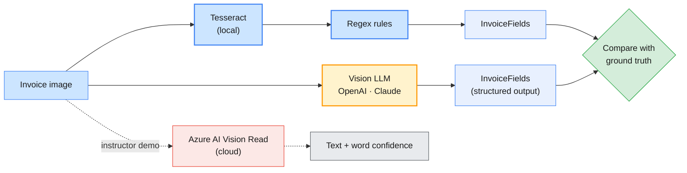
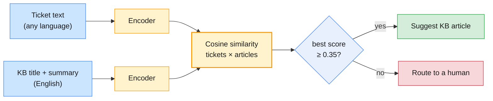

# Lab 02 — Document intelligence: OCR and multilingual embeddings

| | |
| --- | --- |
| **Level** | Beginner → Intermediate |
| **Duration** | ~75 minutes |
| **Covers** | H3 OCR lab: Tesseract on invoice and support-ticket samples + cloud OCR (Azure AI Vision) comparison demo (45 min) · H4 multilingual embeddings and semantic similarity with Sentence Transformers (30 min) |
| **Guide sections** | §4.1 Traditional vs AI-assisted OCR · §4.3 The Tesseract pipeline · §4.4 Cloud OCR · §4.5 AI-assisted extraction · §7.2 Sentence Transformers · §7.3 Multilingual embeddings · §7.4 API embeddings · §7.5 Thresholds, evaluation and failure modes |
| **Notebook** | [`notebooks/lab-02-ocr-multilingual-embeddings.ipynb`](notebooks/lab-02-ocr-multilingual-embeddings.ipynb) · solution in [`solutions/`](solutions/lab-02-ocr-multilingual-embeddings.ipynb) |
| **You will need** | Lab 01's environment; **Tesseract 5.x** on `PATH`; the two Sentence Transformers models from `prefetch_models.py`; both API keys for Part 3. Part 4 is an instructor demo: you need no Azure credentials. |

## Learning objectives

By the end of this lab you will be able to:

1. **Run** Tesseract on scanned business documents and **measure** its accuracy with the character error rate (CER) against known text.
2. **Diagnose** whether an OCR error comes from layout (reading order) or from image quality, and **fix** each one: page segmentation mode, then preprocessing.
3. **Compare** traditional OCR plus rules with AI-assisted OCR (OpenAI and Claude vision with structured output) on accuracy, latency, cost and the risk of invented values.
4. **Explain** why a schema that cannot express "absent" makes a model invent a value, and **design** the schema that prevents it.
5. **Compare** an English-only and a multilingual embedding model on cross-lingual similarity, and **build** a ticket-to-KB matcher that works in six languages.
6. **Connect** OCR and embeddings into one pipeline, from ticket image to knowledge-base article, with an escalation threshold.

---

## Part 1 — Generate the samples and run Tesseract (10 min)

You create four synthetic documents with known text and read them with a local OCR engine.

The setup cell runs [`data/make_samples.py`](data/make_samples.py) if the images are missing. The
script draws each document with Pillow, then degrades two of them the way real scanners and phones do:

| File | Document | Condition |
| ---- | -------- | --------- |
| `INV-88341_clean.png` | Invoice from Bluefin Network Supplies Ltd (synthetic) | Clean digital render |
| `INV-88342_scan.png` | Second invoice, **no PO number printed** | Skew, blur, low contrast, speckle, JPEG artefacts |
| `INC-104233_ticket.png` | Incident record: disk-encryption recovery key | Clean printout |
| `INC-104251_photo.png` | Incident record: email stuck in outbox | Phone photo: rotation, perspective, uneven light |

It also writes `data/samples/ground_truth.json` with each document's exact text and fields, so
every result in this lab can be scored. The images are generated, not committed, and git ignores them.

```python
# (notebook)
default_text = pytesseract.image_to_string(Image.open(SAMPLES_DIR / CLEAN_INVOICE))
```

**Expected** (Tesseract 5.5.3; abridged):

```
(0.38s, local, no network)

INVOICE

Bluefin Network Supplies Ltd
…
Invoice number: INV-88341
…
Description

24-port managed switch
10G SFP+ transceiver
Cat6 patch cable 2m
…
Qty
4
12
40

Unit price
412.00
…
```

Look closely: every word is right, but the table came out **column by column**. Keep that in mind for Part 2.

`image_to_data` returns every word with a position and a confidence from 0 to 100. On the poor scan:

**Expected:**

```
110 words on the scan · median confidence 47
              text  conf  left  top  block_num  line_num
123              ;   0.0   377  646         13         1
33             PAB   0.0   565  224          4         1
82   iFOperations-   0.0   313  486          8         4
…
```

> Low-confidence words are where a human reviewer should look first. Confidence is the one
> signal traditional OCR gives you that an LLM does not.

**Expected:** `✅ Part 1 — Tesseract runs`

---

## Part 2 — Measure accuracy, fix the layout, clean the scan (15 min)

You put a number on OCR quality, find the biggest cause of error, fix it, and then extract fields (§4.3).

```python
# (notebook)
def cer(predicted: str, reference: str) -> float:
    """Character error rate after collapsing whitespace."""
    reference = normalise_ws(reference)
    return Levenshtein.distance(normalise_ws(predicted), reference) / max(len(reference), 1)
```

**Expected** (Tesseract 5.5.3 defaults):

```
                document  default (psm 3)
0    INV-88341_clean.png            0.403
1     INV-88342_scan.png            0.499
2  INC-104233_ticket.png            0.002
3   INC-104251_photo.png            0.191
```

A **clean** invoice with 40% character errors? The characters are fine. The reading order is not.
Page segmentation mode 3 (the default) finds the table's columns and emits them as separate blocks.
Mode 4 treats the page as one column of variable-size text and keeps each row together:

**Expected:**

```
--- psm 3: lines 11-17
Description
24-port managed switch
10G SFP+ transceiver
Cat6 patch cable 2m
Payment terms: 30 days net. Bank details on file.
SYNTHETIC SAMPLE - TRAINING USE ONLY
Qty
--- psm 4: lines 11-17
Description Qty Unit price Amount
24-port managed switch 4 412.00 1,648.00
10G SFP+ transceiver 12 38.50 462.00
Cat6 patch cable 2m 40 3.20 128.00
Subtotal 2,238.00
VAT 20% 447.60
TotalEUR 2,685.60
```

Layout fixed. Now image quality: the preprocessing function converts to grey, stretches contrast,
removes speckle with a median filter, estimates and corrects skew (by maximising the variance of the
row profile), and binarises with Otsu's threshold.

```python
# (notebook)
def preprocess(image: Image.Image) -> tuple[Image.Image, float]:
    grey = ImageOps.autocontrast(ImageOps.grayscale(image), cutoff=1).filter(ImageFilter.MedianFilter(3))
    angle = estimate_skew(grey)
    grey = grey.rotate(angle, resample=Image.Resampling.BICUBIC, fillcolor=255)
    pixels = np.asarray(grey)
    return Image.fromarray(((pixels > otsu_threshold(pixels)) * 255).astype(np.uint8)), angle
```

**Expected:**

```
                document  default (psm 3)  psm 4  preprocessed + psm 4  skew corrected (°)
0    INV-88341_clean.png            0.403  0.004                 0.011                0.00
1     INV-88342_scan.png            0.499  0.492                 0.029               -1.75
2  INC-104233_ticket.png            0.002  0.000                 0.008                0.00
3   INC-104251_photo.png            0.191  0.209                 0.129                3.50
```

| Finding | Evidence |
| ------- | -------- |
| Layout dominated the clean invoice's error | psm 4 alone: 0.403 → 0.004 |
| Image quality dominated the scan's error | psm 4 alone barely helps (0.492); preprocessing gets 0.029 |
| Preprocessing slightly **hurts** clean images | 0.004 → 0.011: never preprocess blindly; measure |
| Perspective is not corrected | The photo stays at 0.129: the deskew handles rotation only |

> **Your numbers may differ.** Tesseract versions differ (Ubuntu 22.04 ships 4.1). The
> relationships matter, not the third decimal.

### From text to fields: your first TODO

Finance does not want text; it wants **fields**. `InvoiceFields` is the target schema for this part
and the next:

```python
# (notebook)
class InvoiceFields(BaseModel):
    invoice_id: str | None = Field(description="Invoice number exactly as printed, e.g. INV-12345")
    invoice_date: str | None = Field(description="Invoice date as ISO 8601 YYYY-MM-DD")
    po_number: str | None = Field(description="Purchase-order number exactly as printed, or null if the document shows none")
    vendor_name: str | None = ...
    currency: str | None = ...
    total: str | None = Field(description="Grand total as digits with a decimal point and no separators, e.g. 2685.60")
```

**Your task:** implement `extract_invoice_fields(text) -> InvoiceFields` with regular expressions.
The contract: any field you cannot find is `None`, never a guess; `invoice_date` is ISO; `total`
has no thousands separators.

> **Common trap:** you write `Total\s+EUR` from looking at the image, but OCR printed `TotalEUR`.
> Print your OCR text and write the pattern against **it**. And match `PO number:[ \t]*`, not
> `\s*`: `\s` crosses the line break and captures the next line's text as the PO number.

**Expected** with a correct extractor (preprocessed text, psm 4):

```
              INV-88341_clean.png  INV-88342_scan.png
invoice_id                   True                True
invoice_date                 True                True
po_number                    True                True
vendor_name                  True                True
currency                     True                True
total                        True                True
```

The scan's `po_number` is `True` because your extractor returned `None`, and `None` is the truth.

**Expected:** `✅ Part 2 — CER and field extraction` (while the TODO is open, the check prints `⏳ … TODO not implemented yet`)

---

## Part 3 — AI-assisted OCR with OpenAI and Claude vision (15 min)

A multimodal model reads the image and fills the schema in one step (§4.5). You compare it with your rule-based pipeline.



Both providers get the same image and the same `InvoiceFields` schema:

```python
# (notebook)
openai_client.responses.parse(
    model=OPENAI_MODEL,
    input=[{"role": "user", "content": [
        {"type": "input_text", "text": EXTRACTION_PROMPT},
        {"type": "input_image", "image_url": f"data:image/png;base64,{image_b64(path)}", "detail": "high"},
    ]}],
    text_format=InvoiceFields, reasoning={"effort": "low"}, max_output_tokens=4_000,
)                                                                    # → response.output_parsed

claude_client.messages.parse(
    model=ANTHROPIC_MODEL, max_tokens=4_000, output_config={"effort": "low"}, output_format=InvoiceFields,
    messages=[{"role": "user", "content": [
        {"type": "image", "source": {"type": "base64", "media_type": "image/png", "data": image_b64(path)}},
        {"type": "text", "text": EXTRACTION_PROMPT},
    ]}],
)                                                                    # → message.parsed_output
```

| | OpenAI | Claude |
| --- | --- | --- |
| Image part | `{"type": "input_image", "image_url": "data:…"}` | `{"type": "image", "source": {"type": "base64", …}}` |
| Schema argument | `text_format=InvoiceFields` | `output_format=InvoiceFields` (sent as `output_config.format`) |
| Parsed result | `response.output_parsed` | `message.parsed_output` |

**Output shape** (fields, timings and tokens depend on your run):

```
   openai · INV-88341_clean.png    …s · ….. tokens · {'invoice_id': '…', 'invoice_date': '…', 'po_number': …, …}
   openai · INV-88342_scan.png     …
anthropic · INV-88341_clean.png    …
anthropic · INV-88342_scan.png     …
```

The accuracy cell puts all three approaches in one table, with a `fields correct` row out of 6 per document.

### Deliberate failure: a schema that cannot say "absent"

`INV-88342` has an empty PO number field. The prompt says "use null", but what if the schema someone
wrote makes `po_number` a required string?

```python
# (notebook)
class InvoiceFieldsNoNull(InvoiceFields):
    po_number: str = Field(description="Purchase-order number")
```

**Output shape:**

```
    provider  po_number (nullable schema)  po_number (no-null schema)  no-null value correct?
0     openai                         None                       <…>                   False
1  anthropic                         None                       <…>                   False
```

With a required string, structured output **must** return a string. You will see an empty
string, `"N/A"`, `"not provided"`, or an invented `PO-…`. Your ERP would store every one of them.
The instruction and the schema contradicted each other, and the schema won.

> **Production habit:** every optional business field is nullable in the schema, the prompt says
> when to use null, and validation rejects placeholder strings such as `"N/A"`.

**Expected:** `✅ Part 3 — AI-assisted OCR`

---

## Part 4 — Cloud OCR comparison: instructor demo (5 min)

Your instructor runs [`instructor/cloud_ocr_demo.py`](instructor/cloud_ocr_demo.py) (§4.4) on the same four
images with **Azure AI Vision Read** (Image Analysis 4.0) and shows the lines, word confidences and latency.

```bash
# (instructor) - from the repo root, AZURE_VISION_* in the instructor's .env
python labs/module-01/instructor/cloud_ocr_demo.py --sample INV-88342_scan.png
```

If the instructor shares the `*.azure.json` result files, copy them into `data/cloud_ocr/` and run
the next cell: it adds an *Azure AI Vision Read* column to your CER table. Otherwise:

**Expected:**

```
ℹ️  No cloud OCR results in data/cloud_ocr/: watch the instructor's demo and fill in the table below.
```

> **Outline vs current service.** The outline names Azure AI Vision OCR. Microsoft retires the
> Image Analysis API, Read included, on **25 September 2028** and recommends **Azure Document
> Intelligence** (prebuilt Read model) for OCR. AWS Textract is the AWS equivalent, covered as an
> overview only. The trade-offs below apply to all of them.

📝 Fill in the **Record (Parts 1–4)** table in the notebook. The rows that matter most in an enterprise:

| Criterion | Tesseract | AI-assisted (LLM) | Cloud OCR |
| --------- | --------- | ----------------- | --------- |
| Data leaves your network | No | Yes | Yes (pick the region) |
| Per-word confidence | Yes | No | Yes |
| Can invent a value not on the page | No | **Yes** | No |
| Understands layout and fields | Only via your rules | Yes | Layout yes; fields need a model (Document Intelligence) |

---

## Part 5 — Multilingual embeddings and semantic similarity (15 min)

You compare how an English-only and a multilingual model place the same meaning written in six languages (§7.2, §7.3).

```python
# (notebook)
EMBEDDING_MODELS = {
    "english-only": "sentence-transformers/all-MiniLM-L6-v2",
    "multilingual": "sentence-transformers/paraphrase-multilingual-MiniLM-L12-v2",
}
vectors = encoder.encode(list(SAME_SENTENCE.values()), normalize_embeddings=True)
vectors @ vectors[0]          # cosine similarity to the English sentence
```

Both produce 384-dimensional vectors. *"The VPN client rejects my new password"* in six languages:

**Expected:**

```
               en    de    fr    es    hi    ja
english-only  1.0  0.43  0.46  0.37  0.31  0.25
multilingual  1.0  0.97  0.96  0.99  0.97  0.95
```

The multilingual model was trained on parallel sentences, so translations land almost on top of
each other. The English-only model only sees shared sub-words: the Latin-script `VPN` explains why
it is not at zero for Hindi and Japanese.

Then meaning versus shared words, and two traps from §7.5:

**Expected:**

```
                                 sentence A                                        sentence B  word overlap  cosine (english-only)  cosine (multilingual)
0        My laptop won't connect to the VPN           Remote-access tunnel fails to establish          0.08                   0.37                   0.36
1        My laptop won't connect to the VPN            My laptop won't connect to the printer          0.78                   0.51                   0.49
2        My laptop won't connect to the VPN                       The canteen is closed today          0.08                   0.15                   0.06
3   The VPN works after the password change  The VPN does not work after the password change          0.56                   0.98                   0.96
4        Escalate INC-104233 to Network Ops                Escalate INC-104234 to Network Ops          0.71                   0.99                   0.97
```

What to notice:

- Both models rank the meaning-only paraphrase (row 0) well above the unrelated sentence (row 2),
  even though the two share the same 0.08 word overlap.
- The printer sentence (row 1), with almost the same words and a different problem, still
  outscores the paraphrase. Cosine similarity is a **ranking** signal, not a probability. Compare
  scores within one query; do not read 0.5 as "50% similar".
- **Negation** (row 3) barely moves the vector: "works" and "does not work" score 0.96–0.98.
- **Identifiers** (row 4) are invisible: two different incidents score 0.97–0.99. Never match
  `INC-…`, `KB-…` or `PO-…` numbers by embedding. Extract them with a pattern and look them up exactly.

**Expected:** `✅ Part 5 — similarity`

---

## Part 6 — Match multilingual tickets to KB articles (15 min)

You build the matcher, measure it per language, and connect it to Part 1's OCR. Thresholds and failure modes are in §7.5.

[`data/multilingual_tickets.csv`](data/multilingual_tickets.csv) holds 28 synthetic tickets
(`INC-104301` to `INC-104328`) in English, German, French, Spanish, Hindi and Japanese, each labelled
with its correct article. [`data/kb_articles.csv`](data/kb_articles.csv) holds seven English KB
articles (`KB-0042` … `KB-0608`). Three of them (VPN password, account lockout, MFA push) are deliberately close.



**Your task:** implement `match_tickets(encoder, tickets, kb)`. It returns one row per ticket with
the columns `ticket_id, language, gold_kb, predicted_kb, score, correct`. Embed each KB article as
`"title. summary"`, normalise, take the dot product, and pick the argmax.

**Expected** with a correct matcher:

```
          english-only  multilingual
language
de                0.60           1.0
en                1.00           1.0
es                0.25           1.0
fr                0.75           1.0
hi                0.40           1.0
ja                0.40           1.0
ALL               0.57           1.0
{'english-only': 'median best score 0.11', 'multilingual': 'median best score 0.70'}
```

The escalation rule shows the production consequence:

**Expected:**

```
english-only: 23 of 28 tickets would go to a human (score < 0.35)
multilingual:  0 of 28 tickets would go to a human (score < 0.35)
```

The English-only model is not only less accurate; it is **unsure** about almost everything. With a
sensible threshold it would push most of the queue to humans. The threshold is a product decision:
tune it on labelled data (Module 3 measures retrieval properly).

Finally, end to end: ticket **image** → OCR (Part 2's preprocessing, psm 4) → embedding → article:

**Expected:**

```
                   image predicted                                         title  score expected
0  INC-104233_ticket.png   KB-0450  Laptop asks for the disk-encryption recovery k…  0.670  KB-0450
1   INC-104251_photo.png   KB-0521                 Outgoing email stuck in the outbox  0.447  KB-0521
```

The photographed ticket still matches, with a lower score: the OCR noise from Part 2 shows up as
lower confidence downstream.

The last cell optionally runs the same task through OpenAI's hosted embeddings
(`OPENAI_EMBEDDING_MODEL`). On the Claude side there is nothing to call: Anthropic does not offer an
embedding model of its own and points to Voyage AI. A local Sentence Transformers model, as here,
serves Claude-based pipelines equally well.

**Expected:** `✅ Part 6 — multilingual matching`

---

## Checkpoint questions

<details>
<summary>1. The clean invoice scored a CER of 0.40 with Tesseract's defaults. What was wrong, and why does it matter for field extraction?</summary>

Nothing was wrong with character recognition. Page segmentation mode 3 split the table into
column blocks, so the reading order differed from the true text. For field extraction this is
worse than a few misread characters. A rule like "the amount on the Total line" fails when amounts
and labels are in different blocks. Choose the segmentation mode for your document type (psm 4
for single-column forms and invoices), and measure.
</details>

<details>
<summary>2. Preprocessing improved the scan from 0.49 to 0.03 but made the clean invoice slightly worse. What do you do in a production pipeline?</summary>

Do not apply one fixed chain to everything. Detect the condition first: estimated skew, contrast,
the median word confidence from `image_to_data`. Preprocess only when the image needs it, or run
both variants and keep the one with the higher mean confidence. Keep a labelled sample set like
`ground_truth.json` and re-measure CER whenever you change the chain.
</details>

<details>
<summary>3. Why did the no-null schema produce a value for a PO number that is not on the page, even though the prompt said "use null"?</summary>

Structured output constrains generation to the schema. When `po_number` is a required string,
`null` is not a legal output, so the model must emit some string. The instruction and the
contract conflicted, and the contract won. Make absent-able fields nullable, and treat placeholder
strings as validation errors.
</details>

<details>
<summary>4. Which OCR approach would you choose for UC-3 (EU-only invoices, 1,500 a day, overnight), and what would you measure before deciding?</summary>

A defensible answer is a hybrid: local or in-region OCR for text and word confidence, then an LLM
with a nullable schema for field extraction, plus validation rules (totals add up, the PO exists
in the ERP). Measure field accuracy on a labelled sample, the rate of invented values, the cost
per document, and whether data stays in the EU. Lab 03 turns this into a costed decision.
</details>

<details>
<summary>5. The English-only model matched the Hindi VPN ticket correctly some of the time. Why, and why is that dangerous?</summary>

Tokens such as `VPN` and `MFA` are Latin script, so they create lexical overlap even across
languages. The match is right for the wrong reason. A Hindi ticket about a printer has no such
anchor and fails, so accuracy depends on vocabulary rather than meaning. Per-language evaluation,
not overall accuracy, exposes this.
</details>

<details>
<summary>6. A user writes "same problem as INC-104233". Why should the assistant not find that ticket by embedding similarity?</summary>

Embeddings encode meaning, not exact strings: `INC-104233` and `INC-104234` scored 0.97–0.99 in
Part 5, so the nearest neighbour may be a different incident. Identifiers need exact handling:
extract them with a pattern, look them up in the ticketing system, and use embeddings only for
the free-text description. Module 3 combines the two as hybrid retrieval (keyword + vector).
</details>

---

## Clean up

```bash
# (terminal) - from labs/module-01
rm -rf data/cloud_ocr          # instructor result files, if you copied them
# data/samples/ can stay: it is git-ignored and Lab 03 does not need it
```

Keep the cached embedding models: later modules reuse multilingual embeddings for retrieval.

**Next:** [Lab 03 — Mapping use cases and selecting models](lab-03-use-cases-model-selection.md)
