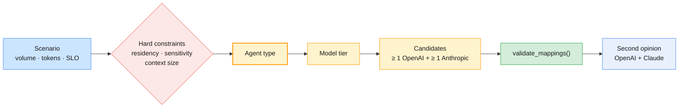

# Lab 03 — Mapping use cases and selecting models

| | |
| --- | --- |
| **Level** | Intermediate |
| **Duration** | ~45 minutes |
| **Covers** | H1 Enterprise use-case mapping: teams match agent type to model family across 4 IT scenarios (30 min) · H5 Model selection exercise: cost vs capability decision matrix for a given enterprise scenario (15 min) |
| **Guide sections** | §2.4 Agent types · §8.1 Proprietary vs open-weight · §8.2 The OpenAI and Claude model families · §8.3 Cost modelling · §8.4 The cost vs capability decision matrix · §8.5 Responsible AI |
| **Notebook** | [`notebooks/lab-03-use-cases-model-selection.ipynb`](notebooks/lab-03-use-cases-model-selection.ipynb) · solution in [`solutions/`](solutions/lab-03-use-cases-model-selection.ipynb) |
| **You will need** | Lab 01's environment and both API keys (the review and tier probe in Parts 2–3; everything else runs offline); `OPENAI_SMALL_MODEL` and `ANTHROPIC_SMALL_MODEL` set for the tier probe; a team of 3–4 |
| **Artefact** | [`templates/model-comparison-sheet.md`](templates/model-comparison-sheet.md): the notebook fills one per scenario into `outputs/` |

> **Scheduling note.** H1 comes first in the outline. Your instructor may run Parts 1–2 on the
> Day 1 morning, straight after the GenAI landscape topic, and keep Parts 3–4 for the end of the day.

## Learning objectives

By the end of this lab you will be able to:

1. **Characterise** an enterprise AI use case by volume, token shape, latency target and hard constraints (residency, sensitivity, languages).
2. **Map** a use case to an agent type and a model tier, with at least one OpenAI and one Anthropic candidate, and **justify** it in architecture-review language.
3. **Validate** a mapping against a model catalogue: context-window fit, provider coverage, deployment consistency.
4. **Build** a monthly cost model that accounts for caching, batch discounts and long-context pricing, and **test** it against hand-calculated cases.
5. **Rank** candidates with a weighted decision matrix, **test** how sensitive the ranking is, and **record** the decision, including a Responsible AI check, in the model comparison sheet.

---

## Part 1 — Frame the four scenarios (5 min)

You read four IT scenarios as a team and note what rules options in or out.

[`data/use_case_scenarios.json`](data/use_case_scenarios.json) describes them:

**Expected:**

| id | title | team | requests/day | avg in / out tokens | max input | latency SLO (s) | tools | documents | batch OK |
| -- | ----- | ---- | ------------ | ------------------- | --------- | --------------- | ----- | --------- | -------- |
| UC-1 | Service Desk ticket triage and routing | Service Desk | 6000 | 900 / 80 | 4,000 | 2 | False | False | False |
| UC-2 | Major-incident root-cause assistant | Network Ops | 120 | 60,000 / 2,500 | 300,000 | 90 | True | True | False |
| UC-3 | Invoice and contract field extraction | Finance | 1500 | 3,500 / 400 | 20,000 | 3600 | False | True | True |
| UC-4 | Multilingual employee IT help assistant | Platform Engineering | 3000 | 6,000 / 350 | 30,000 | 6 | True | True | False |

Each scenario also records its residency rule, its data sensitivity, its languages and its accuracy bar.

Agent types to choose from (§2.4):

| Agent type | What it is | Built in |
| ---------- | ---------- | -------- |
| Single-call classifier | One request, one structured answer: routing, triage, tagging | Module 2 Lab 01 |
| Extraction pipeline | A fixed workflow (OCR → LLM extraction → validation) your code orchestrates; batchable | Lab 02 of this module |
| RAG assistant | Retrieve passages, answer from them, cite them | Module 3 |
| Tool-using agent | The model decides which tools to call in a loop (ReAct); a human approves risky actions | Module 2 Lab 04 |
| Multi-agent orchestration | A supervisor routes work to specialist agents | Module 4 |

And the model catalogue, [`data/model_catalogue.json`](data/model_catalogue.json): ten models at
list prices on 2026-10-27, with the source URLs in the file (§8.1, §8.2).

| Tier | Anthropic | OpenAI | Open weights (self-hosted) |
| ---- | --------- | ------ | -------------------------- |
| Frontier | `claude-fable-5-1` ($10 / $50) · `claude-opus-5-5` ($4 / $20) | `gpt-6-astra` ($10 / $50) | — |
| Balanced | `claude-sonnet-5-5` ($2 / $10) | `gpt-6.1-sol` ($2 / $10) · `gpt-6.1-terra` ($1 / $5) | `gpt-oss-120b` |
| Fast | `claude-haiku-5-5` ($0.10 / $0.50) | `gpt-6-luna` ($0.10 / $0.50) | `gpt-oss-20b` |

Prices are input / output USD per 1M tokens. The open-weight models have no token price: you
pay for GPUs and operations, and their context window is 131,072 tokens.

> **Bridge from what you know:** this is a build-vs-buy and capacity-planning exercise with an
> unusual meter. The cost scales with **tokens**, not with requests or CPU time.

---

## Part 2 — Map each scenario to an agent type and a model family (25 min)

You make the architecture decision as a team, encode it as data, and let code and two models review it.

**Team roles** (rotate per scenario): a **facilitator** keeps to about 5 minutes per scenario; a
**scribe** types the mapping; a **sceptic** argues for the cheapest option that could work; a
**risk owner** writes the risks.



A mapping is data with a schema. Pydantic rejects an unknown agent type, fewer than two candidates,
a one-line rationale or an empty risk list:

```python
# (notebook)
class UseCaseMapping(BaseModel):
    scenario_id: str
    agent_type: AgentType            # one of the five types above
    model_tier: Literal["frontier", "balanced", "fast"]
    deployment: Literal["public API", "regional API", "self-hosted open weights"]
    candidates: list[str] = Field(min_length=2)
    rationale: str = Field(min_length=40)
    risks: list[str] = Field(min_length=1)
```

**Your task:** complete `team_mappings()`. UC-1 is given as a worked example:

```python
# (notebook)
UseCaseMapping(
    scenario_id="UC-1",
    agent_type="single-call classifier",
    model_tier="fast",
    deployment="regional API",
    candidates=["claude-haiku-5-5", "gpt-6-luna"],
    rationale="High volume, tiny outputs and a 2-second SLO: a fast tier with a structured-output schema "
    "is enough, and per-request cost dominates. No tools or loop needed.",
    risks=["misrouted P1s: escalate low-confidence labels to a human", "quality may differ by language"],
)
```

Questions to argue about:

- **UC-2:** does a P1 assistant that reads 60,000 tokens a turn need the frontier tier? Which candidates can even hold its 300,000-token worst case?
- **UC-3:** the data must stay in the EU, and the job runs overnight. What does that do to latency as a criterion, and to the deployment choice?
- **UC-4:** six languages and a citation requirement. Is this a model problem or a retrieval problem?

The check cell validates your mappings against the catalogue:

| Rule | Why |
| ---- | --- |
| Every scenario mapped exactly once | Completeness |
| Every candidate exists in the catalogue | No made-up model IDs |
| At least one OpenAI **and** one Anthropic API model per scenario | The course compares both providers; a single-vendor shortlist is a risk |
| Every candidate's window ≥ the scenario's `max_input_tokens` | A model that cannot hold the worst case is not a candidate |
| `self-hosted open weights` deployment ⇒ an open-weight candidate | Consistency |

> **Common trap:** putting `gpt-oss-120b` on UC-2's shortlist because it is self-hosted. The check
> fails with `UC-2: gpt-oss-120b holds 131,072 tokens but the scenario needs 300,000`. Residency
> alone does not make a model a fit.

**Expected:** `✅ Part 2 — mappings` (while the TODO is open: `⏳ Part 2 — mappings: TODO not implemented yet (team_mappings: UC-2, UC-3 and UC-4)`)

Then both providers review every mapping with the same prompt and the same schema:

```python
# (notebook)
class MappingReview(BaseModel):
    agrees: bool
    biggest_risk: str
    overlooked: list[str]
    suggested_agent_type: AgentType | None
```

**Output shape** (eight rows: four scenarios × two reviewers; content depends on your mappings):

```
  scenario   reviewer  agrees  biggest_risk                        overlooked              suggested_agent_type
0     UC-1     openai    True  <…>                                 [<…>]                   None
1     UC-1  anthropic    …
…
```

Where the two reviewers disagree with each other, or with you, discuss it as a team. The reviews
are inputs to your judgement, not verdicts.

---

## Part 3 — Estimate tokens and cost (7 min)

You measure tokens and latency before you model cost, then write the cost function (§8.3).

First, the sample request of each scenario, counted three ways:

**Expected** offline column (the two API columns depend on your models):

```
          planning avg input  o200k (offline)  OpenAI count  Claude count
scenario
UC-1                     900               74             …             …
UC-2                   60000              109             …             …
UC-3                    3500               86             …             …
UC-4                    6000               78             …             …
```

The sample prompts are under 120 tokens; the planning averages are 900 to 60,000. The difference
is everything the real request carries: ticket history, log excerpts, OCR text, retrieved KB
passages. The instructions are rarely what costs money; the **context** is.

The tier probe then times the UC-1 request on the main and small model of each provider:

**Output shape:**

```
              model  latency (s)   in  out  cost per 1,000 requests ($)  answer
0       gpt-6.1-sol          …      …    …                        …     {"category": …
1        gpt-6-luna          …
2   claude-opus-5-5          …
3  claude-haiku-5-5          …
```

### The cost function: your second TODO

The contract (also in the notebook):

1. Per request: `input_tokens × input price + output_tokens × output price`, prices in USD per 1M tokens.
2. A `cache_hit_rate` share of the input is billed at `cached_input`. Cache-write premiums are ignored.
3. Above a model's `long_context.threshold_tokens`, the **whole** request uses the long-context prices.
4. `batch=True` halves the total (both providers' Batch APIs bill at 50%).
5. Monthly = per request × `requests_per_day` × `days`, rounded to cents.
6. No token price (open weights) → return `self_hosted_monthly_usd`, or raise `ValueError` if it is `None`.

The check cell uses round numbers you can verify by hand:

```python
# (notebook)
# 1,000 in × $1 + 500 out × $5 = $0.0035 per request × 1,000 × 30 = $105.00
assert monthly_cost(TEST_MODEL, TEST_SCENARIO) == 105.00
# half the input cached: 500 × $1 + 500 × $0.10 + 500 × $5 = $0.00305 → $91.50
assert monthly_cost(TEST_MODEL, TEST_SCENARIO, cache_hit_rate=0.5) == 91.50
```

**Expected:** `✅ Part 3 — monthly_cost`

The notebook then prices every model for every scenario, using each scenario's cacheable share and the Batch API where the scenario allows it:

**Expected** (USD per month, list prices on 2026-10-27; `—` = self-hosted, no estimate entered yet):

| model | UC-1 | UC-2 | UC-3 | UC-4 |
| ----- | ---: | ---: | ---: | ---: |
| claude-fable-5-1 | 1,234 | 1,978 | 854 | 3,816 |
| claude-opus-5-5 | 505 | 798 | 345 | 1,559 |
| claude-sonnet-5-5 | 253 | 399 | 173 | 779 |
| claude-haiku-5-5 | 13 | 20 | 9 | 41 |
| gpt-6-astra | 1,319 | 2,027 | 883 | 4,059 |
| gpt-6.1-sol | 253 | 399 | 173 | 779 |
| gpt-6.1-terra | 126 | 199 | 86 | 390 |
| gpt-6-luna | 13 | 20 | 9 | 41 |
| gpt-oss-120b | — | — | — | — |
| gpt-oss-20b | — | — | — | — |

What to notice:

- §8.3 prices UC-1 on Claude Haiku 5.5 / GPT-6 Luna at **$23.40** a month with no caching. Here it
  is **$13**, because 70% of each UC-1 prompt (the system prompt and the priority matrix) is a
  cacheable prefix. Try `cache_hit_rate=0` and you get §8.3's figure back.
- Within a provider, tiers span about **100×**. Across providers, the same tier often costs the same.
- In absolute terms, even the frontier tier is cheap for UC-2 (120 requests a day). There, capability
  and evidence matter far more than the bill.
- To compare the open-weight models, enter a monthly infrastructure estimate in
  `SELF_HOSTED_MONTHLY_USD` (GPUs, the on-call time, upgrades) and run the cell again.

> **Pricing details that change real decisions:** Claude's US-only inference (`inference_geo`)
> multiplies every token price by 1.1. Claude Haiku 5.5 charges more above 100K prompt tokens.
> OpenAI's flagship models charge more above 272K. All of these are in the catalogue's `pricing_notes`.

---

## Part 4 — Score, decide and write it up (8 min)

You turn the numbers into a ranked, defensible decision for one scenario (§8.4). The notebook
starts with **UC-1**, the guide's example. Then you switch to UC-3.

```python
# (notebook)
SCENARIO_ID = "UC-1"  # the guide's §8.4 example; try "UC-3" next
WEIGHTS = {"capability": 0.25, "latency": 0.10, "cost": 0.25, "residency": 0.20,
           "multilingual": 0.10, "operability": 0.10}
```

Five criteria come from `starter_ratings()`, a few transparent rules of thumb (frontier = 5
capability, self-hosted = 5 residency, overnight batch = 5 latency, and so on). Read them and
change any you disagree with: they are the team's assumptions, written down. Hard constraints such
as residency are better applied as **filters** before scoring (§8.4, step 2). The sensitivity cell
shows what a filter would leave.

**Your task:** the last two TODOs.

- `cost_ratings(costs)`: cheapest = 5.0, most expensive = 1.0, linear on a **log10** scale; all equal → 5.0.
- `weighted_score(ratings, weights)`: assert the criteria match and the weights sum to 1.0, then return the rounded weighted sum.

**Expected** for UC-1 with the solution's mapping and the default weights:

```
                  capability  latency  residency  multilingual  operability  cost  monthly $  score
claude-haiku-5-5         4.0      5.0        3.0           4.0          5.0   5.0      13.19   4.25
gpt-6-luna               4.0      5.0        3.0           4.0          5.0   5.0      13.19   4.25

Tie at 4.25 between claude-haiku-5-5, gpt-6-luna: apply the tie-breaker you agreed before scoring.
Doubling the cost weight: leader(s) unchanged (claude-haiku-5-5, gpt-6-luna).
A self-hosted-only residency rule leaves: no candidate: add an open-weight model or a regional API.
```

A tie is information: both options pass. Break it with a criterion you wrote down **before**
scoring, such as the existing contract, operational familiarity, or a second provider for
resilience. Never break it by nudging a weight until one side wins. The sheet has a
**Tie-breaker** row for exactly this.

Now set `SCENARIO_ID = "UC-3"` and rerun Part 4.

**Expected** for UC-3:

```
                   capability  latency  residency  multilingual  operability  cost  monthly $  score
gpt-6.1-terra             4.0      5.0        3.0           4.0          5.0   5.0      86.34   4.25
gpt-oss-120b              4.0      5.0        5.0           3.0          2.0   3.0        NaN   3.75
claude-sonnet-5-5         4.0      5.0        3.0           4.0          5.0   1.0     172.69   3.25

Doubling the cost weight: leader(s) unchanged (gpt-6.1-terra).
A self-hosted-only residency rule leaves: ['gpt-oss-120b'].
```

Read this matrix critically before you accept it:

- `claude-sonnet-5-5` and `gpt-6.1-terra` tie on every criterion except cost. Terra costs half as
  much, yet min–max scaling turns that 2× difference into 5.0 versus 1.0. With two priced
  candidates, every cost gap looks maximal.
- `gpt-oss-120b` gets a neutral cost of 3.0 only because nobody entered an infrastructure
  estimate. Until someone does, its second place means nothing.
- Starter ratings give every API model the same multilingual score. §8.4 says to replace such
  ratings with **measurements** on a labelled sample: the next step after this lab.

Finally, the notebook fills the template and writes `outputs/model-comparison-<scenario>.md`:

**Expected:** `Wrote outputs/model-comparison-UC-1.md: open it, then edit the TODO lines with your team.`

Edit the `DECISION` strings (the tie-breaker, the trade-off, a review date and the three
Responsible AI answers) and run the export cell again. Write your 3–5 sentence justification in
the notebook's write-up cell. The Responsible AI section of the sheet (§8.5) is the outline's "key
principles" made concrete for one system:

| Principle | The question the sheet asks |
| --------- | --------------------------- |
| Bias | Does quality differ by language, region or user group, and how will you measure it? |
| Transparency | Do users know the output is AI-generated, and can they see its sources? |
| Governance | Who owns the model choice, the prompts and the eval results, and what is logged? |

**Expected:** `✅ Part 4 — scoring and sheet`

---

## Checkpoint questions

<details>
<summary>1. UC-1 costs about $13 a month on the fast tier and about $505 on Claude Opus 5.5. Why might a team still pick a balanced or frontier model?</summary>

If the fast tier misses the 95% routing bar, misrouted P1s cost far more than $500 a month in
delay and rework. Cost is one criterion; the accuracy bar is a constraint. Measure each tier on
the labelled ticket set (Module 2 Lab 01 builds one). Choose the cheapest tier that clears the
bar, and keep the next tier up as a fallback for low-confidence cases.
</details>

<details>
<summary>2. Your decision matrix turned a 2× cost difference into ratings of 5 and 1. What is going on, and how would you fix it?</summary>

Min–max normalisation stretches whatever range it sees to the full scale, so with two candidates
any gap becomes the maximum. Fixes: rate cost against absolute thresholds ("under $100 a month =
5"), rate it against the scenario's budget, or include more candidates so the range is meaningful.
Then rerun the sensitivity check.
</details>

<details>
<summary>3. Why does `validate_mappings()` insist on an OpenAI and an Anthropic candidate for every scenario?</summary>

Two reasons. In this course, every lab compares both providers. In production, a single-vendor
shortlist means one outage, price change, deprecation or policy decision stops your service. A
validated second candidate is your fallback route, and Module 4 routes between models dynamically.
</details>

<details>
<summary>4. UC-3 must keep data in the EU. Which rows of the decision matrix does that change, and what would you verify before trusting the "regional API" choice?</summary>

It changes the residency rating, and it can remove candidates entirely: a hard rule is a filter,
not a weight. Before trusting a regional API, verify where inference runs and where logs and
caches are stored, the provider's retention terms, and any price multiplier for the region.
Module 5 covers residency controls in depth.
</details>

<details>
<summary>5. What evidence would make you change your UC-3 decision six months from now?</summary>

New list prices or models; a field-accuracy eval in which the chosen model falls below 99% or
starts inventing values; a change in volume; a residency or audit finding; or a self-hosting
estimate showing the open-weight route is cheaper at your volume. Record the evidence that
justified the decision now, so that a future change is a comparison, not a debate.
</details>

---

## Clean up

```bash
# (terminal) - from labs/module-01
ls outputs/                    # your filled comparison sheets: keep the ones you want
```

`outputs/` is git-ignored. Copy any sheet you want to keep somewhere outside the repo, or commit
it deliberately with `git add -f`.

**Next module:** *Module 2 — Prompt Engineering, OpenAI & Claude SDKs, LangChain & Single Agent*.
You turn the triage and extraction ideas from these labs into prompts, structured outputs and
tool calls on both SDKs, then build the Enterprise Operations Assistant.
